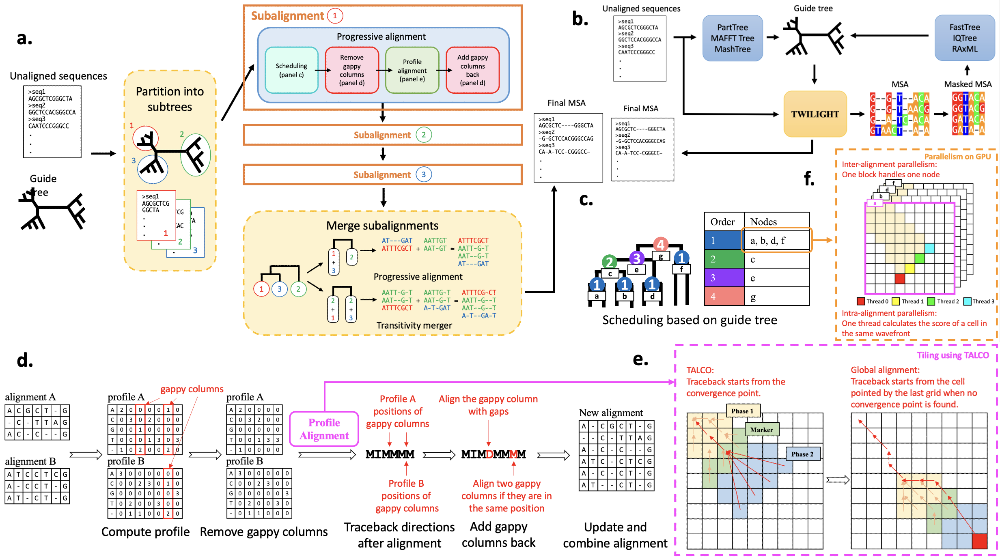

# <b>Welcome to TWILIGHT Wiki</b>
<div align="center">
    
</div>

## <b>TWILIGHT Video Tutorial</b>

<iframe width="1000" height="600" src="https://www.youtube.com/embed/bn8N_Y-_g_A?si=unLXo8xNFAiNDa-K" title="YouTube video player" frameborder="0" allow="accelerometer; autoplay; clipboard-write; encrypted-media; gyroscope; picture-in-picture; web-share" referrerpolicy="strict-origin-when-cross-origin" allowfullscreen></iframe>

## <b>Introduction</b> 
### <b>Overview</b><a name="overview"></a>
TWILIGHT (**T**all and **Wi**de A**lig**nments at **H**igh **T**hroughput) is an innovative MSA tool designed to leverage massive parallelism for efficient handling of tall and wide alignment tasks. It is able to scale to millions of long nucleotide sequences (>10000 bases). TWILIGHT can run on CPU-only platforms (Linux/Mac) or take advantage of CUDA-capable GPUs for further acceleration.

By default, TWILIGHT requires an unaligned sequence file in FASTA format and an input guide tree in Newick format to generate the output alignment in FASTA format (Fig. 1a, see [**TWILIGHT Default Mode**](#default) for more details). When a guide tree is unavailable, users can utilize the iterative mode, which provides a Snakemake workflow to estimate guide trees using external tools (Fig. 1b, see [**TWILIGHT Iterative Mode**](#iterative) for more details).

TWILIGHT adopts the **progressive alignment algorithm (Fig. 1c)** and employs **tiling strategies to band alignments (Fig. 1e)**. Combined with a **divide-and-conquer technique (Fig. 1a)**, **a novel heuristic dealing with gappy columns (Fig. 1d)** and **support for GPU acceleration (Fig. 1f)**, TWILIGHT demonstrates exceptional speed and memory efficiency.  

<div align="center">
    <div><b>Figure 1: Overview of TWILIGHT algorithm</b></div>
    
</div>

### <b>Key Features</b>

#### <b>Divide-and-Conquer Technique</b>  
TWILIGHT's ***divide-and-conquer technique (Fig. 1a)*** starts by dividing the initial guide tree into smaller subtrees with at most *m* leaves, which controls memory usage by limiting the number of sequences processed at once. TWILIGHT sequentially iterates over each subtree, loading its corresponding sequences into memory, and computing the *subalignment* for the subtree. After all *subalignments* are computed, TWILIGHT merges *subalignments* with transitivity merger algorithm of PASTA (Mirarab et al., 2015) or progressive alignment.  

#### <b>Progressive Alignment and Scheduling</b>
TWILIGHT performs progressive alignment based on the guide tree structure, first
aligning the most similar sequences or sequence groups and then progressively adding less similar sequences or groups. The ***scheduling algorithm (Fig. 1c)*** initializes the leaf nodes and then performs a post-order traversal to set the alignment order for internal nodes. This approach allows certain child nodes (e.g., a, b, d, f) to be aligned in parallel, while others (e.g., c, e, g) are processed sequentially, ensuring efficient parallel processing while respecting tree dependencies.  

#### <b>Removing gappy columns</b>  
As more sequences are added, the alignment tends to grow longer, often with many gap-dominated columns, leading to increased computational time. To improve efficiency, TWILIGHT ***excludes gappy columns (Fig. 1d)***—where gaps exceed a specified threshold—before the alignment step, resulting in shorter profiles and reducing computational overhead. After the alignment step, TWILIGHT restores the excluded gappy columns. If gappy columns from both profiles align at the same position, they are merged, reducing the overall alignment length. Otherwise, a gappy column from one profile is aligned with a new gap introduced in the other
profile.  

#### <b>Banded Alignment and Tiling Strategy</b>
TWILIGHT employs a modified X-Drop algorithm to control memory usage in pairwise profile alignment, ensuring linear scaling with sequence length. However, storing traceback pointers in limited GPU shared memory still poses challenges. To address this, TWILIGHT integrates the ***TALCO tiling algorithm  (Walia et al., 2024) (Fig. 1e)***, which limits traceback storage to a constant memory usage by using convergence pointers.  

#### <b>Parallelization Techniques</b>
TWILIGHT employs parallelization techniques on both CPU and GPU to maximize efficiency. On CPUs, it is implemented in C++ with Threading Building Blocks (TBB) to exploit thread-level parallelism, processing independent alignments in parallel while also parallelizing profile calculations and sequence updates. On GPUs, TWILIGHT utilizes ***three levels of parallelism (Fig. 1f)***: multi-GPU parallelism distributes alignment tasks into batches and sends to multiple GPUs, inter-alignment parallelism assigns each GPU thread block to a pairwise profile alignment, and intra-alignment parallelism processes multiple cells in the dynamic programming matrix wavefront simultaneously.  


<a name="install"></a>
## <b>Installation Methods</b>

### **Installation summary (choose your installation method)**

TWILIGHT offers multiple installation methods for different platforms and hardware setups:

- Conda is recommended for most users needing the [default mode](#overview) and *partial* [iterative mode](#overview) support, as some tree tools may be unavailable on certain platforms.
- Install script is required for AMD GPU support.
- Docker (built from the provided Dockerfile) is recommended for full support for [iterative mode](#overview).

| Platform / Setup       | [Conda](#conda) | [Script](#script) | [Docker](#docker) |
|------------------------|-----------------|-------------------|-------------------|
| Linux (x86_64)         | ✅               | ✅                | ✅                |
| Linux (aarch64)        | ✅               | ✅                | 🟡                |
| macOS (Intel Chip)     | ✅               | ✅                | ✅                |
| macOS (Apple Silicon)  | ✅               | ✅                | 🟡                |
| NVIDIA GPU             | ✅               | ✅                | ✅                |
| AMD GPU                | ❌               | ✅                | ❌                |

!!!Note
    🟡 The Docker image is currently built for the `linux/amd64` platform. While it can run on `arm64` systems (e.g., Apple Silicon or Linux aarch64) via emulation, this may lead to reduced performance.

!!!Note
    ⚠️ To enable **GPU support**, the appropriate GPU drivers must be installed on the host system. This applies to all installation methods (Installation script, Conda, and Docker). The CUDA toolkits and libraries are included in Conda and Docker setups, but must be installed manually when using the installation script.  


### **Using Conda** <a name="conda"></a>

TWILIGHT is available on multiple platforms via Conda. See [TWILIGHT Bioconda Page](https://bioconda.github.io/recipes/twilight/README.html) for details.  

0. <a name="installconda"></a> Install Conda (if not installed)
    ```bash
    # Replace <PLATFORM> with the actual platform of your system
    # See https://repo.anaconda.com/miniconda/ for details
    wget https://repo.anaconda.com/miniconda/Miniconda3-latest-<PLATFORM>.sh
    chmod +x Miniconda3-latest-<PLATFORM>.sh
    ./Miniconda3-latest-<PLATFORM>.sh
    export PATH="$HOME/miniconda3/bin:$PATH"
    # Reload shell configuration
    source ~/.bashrc  # For Bash (Most Linux)
    source ~/.zshrc   # For Zsh (Default in Mac)
    ```
1. Create and activate a Conda environment
    ```bash
    conda create -n twilight python=3.11 -y
    conda activate twilight
    # Set up channels
    conda config --add channels defaults
    conda config --add channels bioconda
    conda config --add channels conda-forge
    conda config --set channel_priority strict
    # Install TWILIGHT
    conda install bioconda::twilight
    ```
2. Install TWILIGHT iterative mode
    ```bash
    git clone https://github.com/TurakhiaLab/TWILIGHT.git
    cd TWILIGHT
    bash ./install/installIterative.sh
    ```

### **Using installation script (requires sudo access)** <a name="script"></a>
Users without sudo access are advised to install TWILIGHT via [Conda](#conda) or [Docker](#docker).

1. Clone the repository
    ```bash
    git clone https://github.com/TurakhiaLab/TWILIGHT.git
    cd TWILIGHT
    ```
2. Install dependencies (requires sudo access)  
    TWILIGHT depends on the following common system libraries, which are typically pre-installed on most development    environments:
    ```bash
    - wget
    - build-essential 
    - cmake 
    - libboost-all-dev 
    ```
    It also requires `libtbb-dev`, which is not always pre-installed on all systems. For users who do not have sudo     access and are missing **only** `libtbb-dev`, our script builds and installs TBB from source in the local user  environment, with **no sudo access required**.  
    For Ubuntu users with sudo access, if any of the required libraries are missing, you can install them with:
    ```bash
    sudo apt install -y wget build-essential libboost-all-dev cmake libtbb-dev
    ```
    For Mac users, install dependencies using **Homebrew**:
    ```bash
    xcode-select --install # if not already installed
    brew install wget boost cmake tbb
    ```
3. Build TWILIGHT  
    Our build script automatically detects the best available compute backend **(CPU, NVIDIA GPU, or AMD GPU)** and builds TWILIGHT accordingly. Alternatively, users can manually specify the desired target platform.  
    Automatic build:
    ```bash
    bash ./install/buildTWILIGHT.sh
    ```
    Build for a specific platform:
    ```bash
    bash ./install/buildTWILIGHT.sh cuda # For NVIDIA GPUs
    bash ./install/buildTWILIGHT.sh hip  # For AMD GPUs
    ```
4. The TWILIGHT executable is located in the `bin` directory and can be run as follows:
    ```bash
    cd bin
    ./twilight --help
    ```
5. <a name="install-iter"></a>(optional) Install TWILIGHT iterative mode (ensure [Conda is installed](#installconda) first)
    ```bash
    # Create and activate a Conda environment 
    conda create -n twilight python=3.11 -y
    conda activate twilight
    # Install Snakemake and tree inference tools
    bash ./install/installIterative.sh
    ```

### **Using Dockerfile** <a name="docker"></a> 
The Dockerfile installed all the dependencies and tools for TWILIGHT default/iterative mode.  

1. Clone the repository  
    ```bash
    git clone https://github.com/TurakhiaLab/TWILIGHT.git
    cd TWILIGHT
    ```
2. Build the docker image  
    CPU version  
    ```bash
    cd docker/cpu
    docker build -t twilight .
    ```
    GPU version (using nvidia/cuda as base image)  
    ```bash
    cd docker/gpu
    docker build -t twilight .
    ```
3. Start and run docker container   
    CPU version
    ```bash
    docker run --platform=linux/amd64 -it twilight
    ```
    GPU version  
    ```bash
    docker run --platform=linux/amd64 --gpus all -it twilight
    ```
4. Run TWILIGHT
    ```bash
    ./twilight --help
    ```

## <a name="Run TWILIGHT"></a> **Run TWILIGHT**

### <a name="TWILIGHT CLI"></a> **TWILIGHT Command Line Interface (CLI)**
#### **Main Functionalities**
1. [Build MSA from unaligned Sequences (Default Mode)](#default)
2. [Accurate Mode (Consistency-based Alignment)](#accurate)
3. [Divide-and-Conquer Method](#divide-and-conquer)
4. [Add New Sequences to an Existing Alignment](#add-new-sequences-1)
5. [Merging Multiple MSAs](#merge-msa)
6. [Flexible Tree Support](#flex-tree)

#### **Command Line Options**
<div name="table1" align="center"> <b>Table 1:</b> List of command line options supported by TWILIGHT </div>

| **Option**                       | **Description**                                                                                                      |
|----------------------------------|----------------------------------------------------------------------------------------------------------------------| 
| **Inputs** |
| Build MSA from unaligned Sequences (Default Mode) |
| `-t`, `--tree`                   | Input guide tree file in *Newick format* (required). |
| `-i`, `--sequences`              | Input unaligned sequences file in *FASTA format* (required). |
| Merging Multiple MSAs |
| `-f`, `--files`                  | Path to the directory containing all MSA files in *FASTA format* to be merged. |
| Add New Sequences to an Existing Alignment |
| `-t`, `--tree`                   | Input tree file in *Newick format* with placements for sequences to be aligned (optional). |
| `-i`, `--sequences`              | Input unaligned sequences file in *FASTA format* (required). |
| `-a`, `--alignment`              | Backbone MSAs in *FASTA format* (required). | 
| **Outputs/Files** |
| `-o`, `--output`                 | Output MSA file name (required). |
| `-d`, `--temp-dir`               | Directory for storing temporary files. |
| `-k`, `--keep-temp`              | Keep the temporary directory (default: disabled). |
| `-c`, `--compress`               | Write output files in compressed (.gz) format (default: disabled). |
| `--overwrite`                    | Force overwriting the output file (default: disabled). |
| `--write-prune`                  | Write the pruned tree to the output directory (must be used with `--prune`, default: disabled). |
| **Hardware Usage** |
| `-C`, `--cpu`                    | Number of CPU cores (default: all available cores). |
| Options only for GPU version     |
| `-G`, `--gpu`                    | Number of GPUs (default: all available GPUs). |
| `--gpu-index`                    | Specify the GPU to be used, separated by commas. For example, `0,2,3` uses 3 GPUs with index 0, 2 and 3. |
| `--cpu-only`                     | Run the program only using CPU. |
| **Alignment Parameters** |
| `--type`                         | Data type: `n` for nucleotide, `p` for protein. Automatically inferred if not specified. |
| `-m`, `--max-subtree`            | Maximum number of leaves per subtree; enables [divide-and-conquer method](#divide-and-conquer) (default: `INT_MAX`). |
| `-r`, `--remove-gappy`           | Threshold for removing gappy columns (set to 1 to disable, default: 0.95). |
| `-w`, `--wildcard`               | Treat unknown or ambiguous bases as wildcards and align them to usual letters (default: disabled). |
| `--rooted`                       | Keep the original tree root (disable automatic re-rooting for parallelism, default: disabled). |
| `--prune`                        | Prune the input guide tree based on the presence of unaligned sequences (default: disabled). |
| **Sequence Filtering Options** |
| `--length-deviation`             | Sequences whose lengths deviate from the median by more than the specified fraction will be deferred or excluded. |
| `--max-ambig`                    | Sequences with an ambiguous character proportion exceeding the specified threshold will be deferred or excluded (default: 0.1). |
| `--max-len`                      | Sequences longer than max-len will be deferred or excluded. |
| `--min-len`                      | Sequences shorter than min-len will be deferred or excluded. |
| `--filter`                       | Exclude sequences with high ambiguity or length deviation (default: disabled). |
| `--write-filtered`               | Write the filtered sequences in FASTA format to the output directory. |
| **Scoring Parameters** |
| `--match`                        | Match score (default: 18). | 
| `--mismatch`                     | Mismatch penalty for transversions (default: -8). | 
| `--transition`                   | Score for transitions (default: -4). |
| `--gap-open`                     | Gap-open penalty in normalized units (relative to average match = 1.0). |
| `--gap-extend`                   | Gap-extend penalty in normalized units (relative to average match = 1.0). |
| `--gap-ends`                     | Gap penalty at ends (default: same as gap-extend). |
| `--scale`                        | Matrix and gap normalization scale constant (default: 600.0 for protein, 20.0 for nucleotide). |
| `--xdrop`                        | X-drop value (scale). The actual X-drop will be multiplied by the gap-extend penalty (default: 600). |
| `-x`, `--matrix`                 | Use a user-defined substitution matrix (only for nucleotide). |
| `-b`, `--blosum`                 | Substitution matrix to use for protein sequences: 43 (PFASUM43), 45, 62, 80, or 99 (MIQS) (default: 62). |
| **Accurate Mode Options** |
| `--accurate`                     | Enable accurate consistency alignment (runs pairwise consistency by default; specify `tcs` for Transitive Consistency Score: `--accurate [tcs]`). |
| `--acc-mode`                     | Accurate preset mode: `0`: auto, `1`: all-to-all (slow), `2`: high sample rate (med speed), `3`: low sample rate (fast) (default: 0). |
| `--acc-max-group`                | Maximum number of sequences in a consistency group for accurate mode. |
| `--acc-sample-rate`              | Sample rate for hierarchical consistency representative selection (must be >0, <1). |
| `--acc-sample-top`               | Fraction of representative quota to select by highest centrality (must be >0, <=1). |
| `--consistency-weight`           | Weight multiplier for consistency bonus in accurate mode (default: 5.0). |
| **General** |
| `--check`                        | Check the final alignment. Sequences with no legal alignment will be displayed. |
| `-v`, `--verbose`                | Print out every detail process. | 
| `-h`, `--help`                   | Print help messages and exit. |
| `-V`, `--version`                | Show TWILIGHT version and exit. |


#### **Usages and Examples**

!!!Note
    All files used for the examples below can be found in `TWILIGHT/dataset`.

Enter into the build directory (assuming `$TWILIGHT_HOME` directs to the TWILIGHT repository directory)
```bash
cd $TWILIGHT_HOME/bin
./twilight -h # See Help Messages
```
##### <a name="default"></a> **Build MSA from unaligned Sequences (Default Mode)**  
Generate MSA by giving an unaligned sequence file and a guide tree file.  

* Usage syntax
```bash
./twilight -t <tree file> -i <sequence file> -o <output file>
```
* Example
```bash
./twilight -t ../dataset/RNASim.nwk -i ../dataset/RNASim.fa -o RNASim.aln
```

##### <a name="accurate"></a> **Accurate Mode**  
Incorporates consistency transformation to improve alignment accuracy. 

- `--accurate`: Runs pairwise consistency alignment (default MAFFT-style consistency library, [Katoh & Standley, 2013](https://doi.org/10.1093/molbev/mst010)).
- `--accurate tcs`: Evaluates Transitive Consistency Score (TCS) for position reliability scoring ([Chang et al., 2014](https://doi.org/10.1093/molbev/msu117)).

TWILIGHT offers different presets via `--acc-mode` to balance runtime and consistency sampling:
- `1`: All-to-all (slowest, highest accuracy)
- `2`: High sample rate (medium speed)
- `3`: Low sample rate (fastest)
*(By default, `--acc-mode 0` automatically chooses the optimal preset based on the dataset size).*

!!!Note
    Accurate mode currently executes on CPU only.

* Usage syntax
```bash
./twilight -t <tree file> -i <sequence file> -o <output file> --accurate [tcs] [--acc-mode <0|1|2|3>]
```
* Example
```bash
# Pairwise consistency with automatic mode
./twilight -t ../dataset/RNASim.nwk -i ../dataset/RNASim.fa -o RNASim.aln --accurate

# Transitive Consistency Score (TCS) with fast preset
./twilight -t ../dataset/RNASim.nwk -i ../dataset/RNASim.fa -o RNASim.aln --accurate tcs --acc-mode 3
```

##### <a name="divide-and-conquer"></a> **Divide-and-Conquer Method**  
Divide tree into subtrees with at most *m* leaves and align them sequentially to reduce the CPU’s main memory usage.

**Combine with Accurate Mode:**  
Divide-and-Conquer can be used together with **Accurate Mode** (`--accurate`), allowing consistency-based alignment to scale to even larger datasets while controlling memory footprint.

* Usage syntax
```bash
./twilight -t <path to tree file> -i <path to sequence file> -o <path to output file> -m <maximum subtree size> [--accurate [tcs]]
```
* Example
```bash
# Standard Divide-and-Conquer
./twilight -t ../dataset/RNASim.nwk -i ../dataset/RNASim.fa -o RNASim.aln -m 200

# Divide-and-Conquer with Accurate Mode
./twilight -t ../dataset/RNASim.nwk -i ../dataset/RNASim.fa -o RNASim.aln -m 200 --accurate
```

##### <a name="add-new-sequences-1"></a>  **Add New Sequences to an Existing Alignment**  
For better accuracy, it is recommended to use a tree that includes placements for the new sequences. If no tree is provided, TWILIGHT aligns new sequences to the profile of the entire backbone alignment, which may reduce accuracy. In this case, using the provided [Snakemake workflow](#add-new-sequences-2) is advised.

* Usage syntax
```bash
./twilight -a <backbone alignment file> -i <new sequence file> -t <tree with placement of new sequences> -o <path to output file>
```
* Example
```bash
./twilight -a ../dataset/RNASim_backbone.aln -i ../dataset/RNASim_sub.fa -t ../dataset/RNASim.nwk -o RNASim.aln
```

##### <a name="merge-msa"></a> **Merge Multiple MSAs**  
Assume a star-tree structure to merge multiple MSAs. Please move all MSA files to be merged into one folder.  

* Usage syntax
```bash
./twilight -f <path to the folder> -o <output file>
```
* Example
```bash
./twilight -f ../dataset/RNASim_subalignments/ -o RNASim.aln
```

##### <a name="flex-tree"></a> **Flexible Tree Support**  
Prunes tips that are not present in the unaligned sequence file. This is useful when working with a large tree but only aligning a subset of sequences, without needing to re-estimate the guide tree. Outputting the pruned tree is also supported.

* Usage syntax
```bash
./twilight -t <large tree file> -i <subset of raw sequences> -o <output file> --prune [--write-prune]
```
* Example
```bash
./twilight -t ../dataset/RNASim.nwk -i ../dataset/RNASim_sub.fa -o RNASim_sub.aln --prune --write-prune
```

### <a name="snakemake"></a> **Snakemake Workflow**
TWILIGHT uses the Snakemake workflow to integrate external tools for estimating guide trees and placing new sequences. These are used in iterative mode or when aligning new sequences to existing alignments. For setting up the environment and installing external tools, see [here](#install-iter).  

#### **Main Functionalities**
1. [Iterative Mode](#iterative)
2. [Add New Sequences to an Existing Alignment (Placement Mode)](#add-new-sequences-2)

#### **Command Line Configurations**
| **Configurations**  | **Description and Options**         |
|-----------------------------------------------------|---------------------------------------------------------------------------------------------------| 
| **Snakemake Workflow Configurations**  |
| `-n`                             | Dry run, check workflow. |
| `--cores`                        | Number of CPU cores to use (default: all available cores). Some Snakemake versions may require this to be explicitly set. |
| **User-defined Configurations (used with `--config`)**    |                                                                            |
| **Iterative Mode** |                                                          
| `SEQ`                            | Input unaligned sequences file in *FASTA format* (required). |
| `INITTREE`                       | Tree method for initial guide tree, options: `dipper`, `parttree`, `maffttree` or `mashtree` (default: `parttree`).|
| `ITERTREE`                       | Tree method for intermediate steps, options: `dipper`, `rapidnj` or `fasttree` (default: `rapidnj`).| 
| **Add New Sequences to an Existing Alignment (Placement Mode)**|
| `SEQ`                            | New sequences in *FASTA format* to be placed and aligned (required). |
| `ALN`                            | Backbone alignment in *FASTA format* for placing new sequences (required.) |
| `TREE`                           | Backbone tree (optional; FastTree will be used for estimation if not provided). |
| **General** |
| `TYPE`  | Input sequence type, options: `n` for nucleotide or `p` for protein sequences (required).  |     
| `OUT`                            | Output MSA file path (required).  |
| `DIR`                            | Directory for storing temporary files. |
| `ITER`                           | Number of iterations (default: 3 for Iterative Mode and 2 for Placement Mode). |
| `FINALTREE`                      | Final tree estimation method (skip if unspecified), options: `fasttree`, `raxml` or `iqtree`.|
| `KEEP`                           | Keep the temporary files, options: `yes` or `no` (default: `no`). |
| `OVERWRITE`                      | Overwrite the existing files, options: `yes` or `no` (default: `no`). |

!!!Note
    Default options in `workflow/config.yaml` will be used if the configuration is not specified. You can also modify `workflow/config.yaml` to set your options.
    
!!!Note
    For users who install TWILIGHT via Conda, please replace the executable path `"../bin/twilight"` with `"twilight"` in `config.yaml`. Feel free to switch to a more powerful tree tool if available, such as replacing `"raxmlHPC"` with `"raxmlHPC-PTHREADS-AVX2"` for better performance. 

#### **Usages and Examples**
Enter `workflow` directory and type `snakemake` to view the help messages.   
```bash
cd workflow
snakemake
# or, for Snakemake versions that require specifying total number of cores:
snakemake --cores 1
```

##### <a name="iterative"></a> **Iterative Mode**
TWILIGHT iterative mode estimate guide trees using external tools. 

* Usage syntax
```bash
snakemake [--cores <num threads>] --config TYPE=VALUE SEQ=VALUE OUT=VALUE [OPTION=VALUE ...]
```
* Example - Using default configurations
```bash
snakemake --cores 8 --config TYPE=n SEQ=../dataset/RNASim.fa OUT=RNASim.aln
```
* Example - Generates the final tree based on the completed MSA.
```bash
snakemake --cores 8 --config TYPE=n SEQ=../dataset/RNASim.fa OUT=RNASim.aln FINALTREE=fasttree
```

##### <a name="add-new-sequences-2"></a> **Add New Sequences to an Existing Alignment (Placement Mode)**
TWILIGHT aligns new sequences to the profile of the backbone alignment, infers their placement with external tools, and then refines the alignment using the inferred tree.  

* Usage syntax
```bash
snakemake [--cores <num threads>] --config TYPE=VALUE SEQ=VALUE OUT=VALUE ALN=VALUE [OPTION=VALUE ...]
```
* Example - The backbone alignment is accompanied by a tree.
```bash
snakemake --cores 8 --config TYPE=n SEQ=../dataset/RNASim_sub.fa OUT=RNASim.aln ALN=../dataset/RNASim_backbone.aln TREE=../dataset/RNASim_backbone.nwk
```
* Example - The backbone tree is unavailable, estimate it using external tools and generate a final tree after alignment.
```bash
snakemake --cores 8 --config TYPE=n SEQ=../dataset/RNASim_sub.fa OUT=RNASim.aln ALN=../dataset/RNASim_backbone.aln FINALTREE=fasttree
```

## <b>Contributions</b>
We welcome contributions from the community to enhance the capabilities of TWILIGHT. If you encounter any issues or have suggestions for improvement, please open an issue on [TWILIGHT GitHub page](https://github.com/TurakhiaLab/TWILIGHT). For general inquiries and support, reach out to our team.

## <b>Citing TWILIGHT</b>
If you use the <b>TWILIGHT</b> in your research or publications, we kindly request that you cite the following paper:  

Yu-Hsiang Tseng, Sumit Walia, Yatish Turakhia, "<i>Ultrafast and ultralarge multiple sequence alignments using TWILIGHT</i>", Bioinformatics, Volume 41, Issue Supplement_1, July 2025, Pages i332–i341, doi: [10.1093/bioinformatics/btaf212](https://doi.org/10.1093/bioinformatics/btaf212)